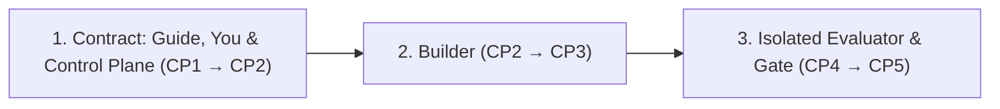

# How Surla Works: The 5 Checkpoints & Isolated Verification

**[← Back to README](../README.md)** · **[Golden Path Architecture →](ARCHITECTURE_PLAYBOOK.md)** · **[CLI & MCP Reference →](REFERENCE.md)**

Surla replaces blind trust in agent-generated diffs with a chain of evidence from **natural-language intent → compiled Goa contract → the builder's implementation → OS-isolated verification**.

Run `surla` in the project folder to start or attach to its server and open your views. The guide saves every Change Card awaiting your confirmation, including requests without open questions. Only your browser session confirms changes and approves results. See [project identity and lifecycle](REFERENCE.md#surla-serve).

---

The project server follows only its registered team handles in its own Herdr
space. The [team API](REFERENCE.md#team-supervision) gives the user each role's
terminal state, watcher fact and unread-assignment fact. Unknown observations
remain unknown; reading this picture never marks an assignment read. A revised
request does not automatically clear an older build's unread assignments. Only the user can ask to show a pane or reopen the launcher.
The views page's **Team** view shows these separate observations and offers
**Start agents** and role-specific **Show pane** controls. A role that needs you
appears above every view. Failed reads retain facts labeled as last read;
unknown observations remain unknown. Automatic reminder delivery is unavailable
in the executable binding.

After confirming a change, choose **Build this change** beside its summary.
The page shows the saved build's revision, assignment reads, required Story test
count and test-writer progress. It follows changes without reloading or losing
unsaved edits. Building uses the agreed saved revision, including while a guide's
proposal waits. **Build again** asks before replacing a current build and clearing
its assignment reads and test-writer verdict; building a newly agreed revision
directly replaces an earlier build. Before refining or adopting a different
agreed revision, the page explains that its build becomes earlier and that a
replacement build's written tests need acceptance again. Saved run labels say
whether the recorded revision and selected tests still match; **Proof** names
the test source and shows the written-test isolation notice.
See [builds and assignments](REFERENCE.md#builds-and-assignments).

## Overview: Strict Separation of Powers

Every change passes through three stages with different owners, so the agent that writes the code never defines the contract alone or grades its own output. The guide drafts the contract and you confirm it, the builder implements it, and an evaluator the builder does not control checks it before you approve the result:



1. **📐 Contract: Guide, You & Control Plane (`CP1` → `CP2`) — Intent Lock, Compiled Contract**
   - Scaffolds a new Goa + Goa-AI starter project over MCP with `init_project` (`POST /workspace/init`) inside `<workspace>/<dir>`, switching the running Surla server's active workspace to it in place without restarting, and surfaces concrete input/outcome examples and open domain questions at `CP1`, freezing a SHA-256 `request_revision` digest once you confirm.
   - Evaluates `design/*.go` inside a sandboxed subprocess at `CP2` (`0` LLM tokens) to extract the C4 topology, tool schemas, and security guardrails (reading `design/*.go` privately for Change Cards and the candidate module snapshot from the bound workspace). While drafting or editing a domain Story in the bound workspace (including before any Goa service or C4 container exists), `refresh_story` (`POST /workspace/story/refresh`) and `get_story_refresh` (`GET /workspace/story/refresh`) evaluate the workspace snapshot in the background and return the observed Stories, actors, complete and draft flows, steps, and open questions in memory (`preview_architecture` still requires at least one Goa API or Service container); passing that succeeded `op_id` as `story_refresh_op_id` to `propose_change` or `revise_change` adopts the evaluated Stories and matching `design/*.go` snapshot into the Change Card and its `request_revision`.
2. **🛠️ Builder (`CP2` → `CP3`) — Golden Path Implementation & Fast Draft Mode**
   - The user starts a build of the agreed revision. Surla saves its Story and design, and the answers, examples and preserved behaviors the user confirmed, then registers the builder and, unless stored verification settings supply the evaluator, the test writer. In a starter project, it prepares the test writer's separate Git working copy and writes one required test entry per finished Story flow. Draft flows require none. Each role keeps its own credential and saved working folder; the test writer reads the saved design, Story, answers, examples and preserved behaviors through its assignment, because it may not read the change, and changes only the copy's test module. The build's result gives the next step for the launcher, including **Reload team** when it was already open. Window trouble leaves the build saved and the roles registered; the user can start the agents afterward. See [Builds and assignments](REFERENCE.md#builds-and-assignments).
   - Builders read `surla://golden-path` and generated `AGENTS_QUICKSTART.md`. Because `goa gen` writes all HTTP/gRPC/MCP/OpenAPI plumbing, the builder implements only the domain and Temporal workflow packages. After editing a local design, `generate_code` regenerates the active application's code over MCP; `target: "eval"` regenerates its public local `eval/` module instead. Builders can edit and regenerate repeatedly on the same server, then call `check_project` to build and test the uncommitted application and `eval/` modules in Linux containers, and `update_dependencies` when Go's output shows a missing `go.sum` or `go.work.sum` entry or a `go.mod` update, before committing for verification (see the [MCP tools reference](REFERENCE.md#mcp-tools)).
   - In `CP3`, `draft_override` updates prompt templates in memory, without rebuilding Go code, on the live target `start_live_target` runs (a `candidate_commit` built as `CP4` builds it and started in `--live` mode by the operator's stored evaluator or, without stored verification settings, by that commit's own test module; see the [`draft_override` reference](REFERENCE.md#mcp-tools)), while refusing to override compiled Go business rules (`compiled_rule`). A runtime override is never what `CP4` verifies: to keep drafted text, edit it into the prompt's source, build and test it (with `check_project` when the Surla server is bound to a workspace), commit, and verify that commit for the same `request_revision`. You can test **Customer** vs. **Approving Manager** flows against the candidate API and stateful simulators.
3. **🛡️ Isolated Evaluator & Gate (`CP4` → `CP5`) — Sandboxed Verification, Crash & Budget Proof**
   - `verify.Run` checks out exact `CandidateCommit` and `SuiteCommit` SHAs, builds the candidate binaries inside a macOS `sandbox-exec` jail (`candidate.Build`), and runs the trusted evaluator suite against them—exposed on the CLI as `surla verify` and on the control plane as `verify_change` (`POST /changes/{change_id}/verifications`), `get_verification` (`GET /verifications/{run_id}`), and `list_verifications` (`GET /changes/{change_id}/verifications`; see [`docs/REFERENCE.md`](REFERENCE.md#mcp-tools)), which run and inspect each verification in a detached supervised process group (`internal/verifyrun`) that survives the Surla server restarts. Without stored verification settings, `verify_change` runs the tests Surla accepted for the change's build, at the commit it recorded, and refuses a change without a build or accepted tests. Those tests were written by a separate agent on the same machine, so their program starts with only `PATH` and a temporary folder in its environment, and every result says where its tests came from. The suite starts each candidate process in its own sandbox (`candidate.Exec`); in the `examples/orders-eval` reference suite, candidate LLM calls also go through the evaluator's gRPC model gateway.
   - Redacts unseen **holdout scenarios** from builder reports (`Report.ForBuilders()`) and re-derives the report from raw evidence to verify `CandidateCommit`, `RequestRevision`, `SuiteID`, `SuiteCommit`, candidate binary `Artifacts` digests, and `Environment` in `verify.Approve`—exposed on the CLI as `surla approve` (which checks a saved report file against explicit flags without recording a card approval) and on the control plane as `approve_merge` (`POST /changes/approve`, which checks the tests currently chosen for the change, loads the report from the project's report store, checks staged binary digests when optional promotion settings are stored, and saves the recorded approval on `ChangeCardResult.approval` in `Options.CardsDir` for the card's authenticated principal without merging or deploying).

---

## Checkpoint 1 (`CP1`): Confirm What Surla Understood

The guide analyzes your feature request itself: it reads the target's current `design/*.go` and the Golden Path playbook served at `surla://golden-path`, then calls `propose_change` with the request and its analysis—a summary, the open questions only you can answer, concrete examples that become checks, and the existing behaviors the change must keep. The tool and field descriptions tell the agent what each part must contain. Surla runs no model and needs no model key for this step: it checks the analysis, assigns its IDs, and saves it as a structured **Change Card**:

```text
Surla · Here's What I Understood (change_id: req-refunds, status: needs_confirmation)
───────────────────────────────────────────────────────────────────────────────────────
Examples (each maps to an isolated evaluator check):
  ✓ check_01  $35 item ($38.50 total)     → Instant store credit, no approval [deterministic]
  ✓ check_02  $75 item ($82.00 total)     → Waits for manager approval        [deterministic]
  ✓ check_03  Manager declines $75 refund → Customer sees reason + support    [model_judged]

Open questions to settle before building:
  ? req-refunds-ambiguity-01  Does "under $50" mean item subtotal or total with tax & shipping?
                              (e.g., $48 item + $6 shipping = $54)
  ? req-refunds-ambiguity-02  What happens at exactly $50.00 — instant credit or manager approval?
```

- **Server-assigned IDs & strict validation**: The generated MCP and HTTP decoders reject an analysis with a missing or blank required field, a `null` list element, fewer than two options for a question, no example, or an unknown `verification_kind`, and both refuse a field the contract does not declare, such as an ambiguity ID chosen by the caller (HTTP answers `400` `decode_payload`; remove the field and send the request again). The control plane then rejects, as `unprocessable`, a question that repeats an option, assigns deterministic `<change_id>-ambiguity-NN` and default `check_01`, `check_02`, ... IDs (matching `goa-ai/eval` `validateID`) in Go code, and saves every text exactly as sent. Surla cannot judge whether the analysis is complete or correct; you do that when you review and confirm the card.
- **Durable project state**: The project server derives one private card, run, and report tree outside the workspace. Its existing exclusive card-store lock lasts through ordered cleanup and running-record removal. Cards are saved with a synced temporary file, atomic rename and directory sync; strict decoding, trailing-data rejection and canonical revision verification protect reads. See the [project server reference](REFERENCE.md#surla-serve).
- **Revision lock & iterative refinement (`revise_change`, `confirm_intent`, `decline_revision`, `get_change`, & `approve_merge`)**: When you answer the open questions on the views page, `confirm_intent` moves the card to `confirmed` and computes a canonical SHA-256 `request_revision` digest. When requirements or scope change on an existing `change_id`, the guide, the only caller that revises, calls `revise_change` (`POST /changes/revise`) with the latest revision's `request_revision` (the waiting proposal's, when one waits), a revised `prompt` (and optional `story_refresh_op_id`), and a new analysis made against that revision (as `get_change` returns it, with its earlier prompt, confirmed answers, open questions, summary, examples, preserved behaviors, and any adopted `stories`). Passing `story_refresh_op_id` adopts the evaluated Stories and matching `design/*.go` snapshot from that succeeded `refresh_story` operation, while omitting `story_refresh_op_id` on a revision that already has `stories` keeps those `stories` and their saved `design_source` together without re-reading the workspace. The analysis accounts for every example of the revision it revises exactly once via `prior_id` or `removed_example_ids`, and Surla rejects it as `unprocessable` when it does not: surviving and edited prior examples keep their IDs, IDs from the immediately prior table (including removed IDs) are reserved while constructing the current revision, and brand-new examples receive the lowest unused `check_NN` ID absent from the prior and resulting tables. The new revision is in `needs_confirmation` (even when `0` open ambiguities remain) with no `answers`, `confirmed_by` or `approval`, because its questions are newly analyzed and can differ from the earlier ones; the guide restates earlier decisions that still hold and checks that they appear in the returned `summary`, `examples`, and `preserved_behaviors`. `revise_change` also re-binds any new `ui_composition`. A change you never confirmed is replaced by the new revision; you then answer its `ambiguities` and confirm its `request_revision` on the views page. An agreed (`confirmed`) change is not replaced: the new revision waits beside it as `proposed_revision`, and the agreed revision stays in force with its answers, confirmation, approval, `stories` and design source, so architecture previews, verification and approval keep working on it. A later revision names the proposal's `request_revision` and replaces it. You adopt the proposal on the views page by answering its questions and confirming it (`confirm_intent` with the proposal's `request_revision`), which makes it the agreed revision under a new `request_revision` with no approval carried over, or decline it (`decline_revision`), which leaves the agreed revision exactly as it was. While a proposal waits, refining the agreed revision is refused until you adopt or decline. Only you confirm: the views page calls `confirm_intent`, which confirms or refines the locked answers or examples while carrying any saved `stories` forward without re-evaluating the workspace (returning the stored card on a no-op submit and minting a new `request_revision` when answers or examples change, which invalidates stale downstream previews, verification reports, and any recorded `approval`). If another editor updates the card first, `get_change` (`GET /changes/{change_id}`) fetches the latest saved `ChangeCardResult`. Whenever `get_change` or a no-op `confirm_intent` reads a card with a recorded `approval`, it checks the tests currently chosen for the change and, when `Options.PromotionTarget` is bound, `PromotionTarget.CurrentArtifacts` for `approval.candidate_commit`: it returns `approval` (and `unverified_approval: nil`) only when the chosen tests' commit still matches `SuiteCommit` and either no `PromotionTarget` is bound or the current `Artifacts` still match; it omits both `approval` and `unverified_approval` on a shallow response copy when the chosen tests changed or `CurrentArtifacts` succeeds with different binary digests (without mutating the saved card or `request_revision`); and when the chosen tests match, `Options.PromotionTarget` is bound, and `CurrentArtifacts` returns an error, it omits `approval` and populates `unverified_approval` (`UnverifiedApprovalItem`, carrying the recorded approval metadata and a path-free operator recovery `reason`, while recording the raw `CurrentArtifacts` error on the `controlplane.check_approval` span) rather than failing the card read. `preview_architecture` and `approve_merge` reject a `request_revision` that is not the revision in force. `surla verify` records the `-request-revision` you pass in its report, and `surla approve` (`verify.Approve`) compares a saved report file with the explicit binding flags its caller supplies without looking up a stored card.

---

## Checkpoint 2 (`CP2`): Review the Compiled Contract

Calling `preview_architecture` against a confirmed Change Card stages the bound workspace's candidate module snapshot inside an isolated subprocess, runs Goa, Goa-AI, and `goa.design/model` evaluation, and returns the bound architecture preview (for local read-only design inspection without a Change Card, `request_revision`, or `design_digest`, run `surla preview -dir <module>` on the CLI to print the raw `designeval.Result`):

```text
Surla · Contract & Build Plan (Request rev #2, Design digest sha256:4f8a...)
───────────────────────────────────────────────────────────────────────────────────────
Scope:    1 edge service (orders), 2 internal services (commerce, payments), 1 agent (refund)
Contract: orders.issue_store_credit & orders.request_refund
          • tenant_id & customer_id injected server-side (omitted from LLM schema)
          • BoundedResult pagination on orders.list_orders & orders.continue_orders
          • Design-time Confirmation gate on orders.request_refund
```

The preview reports what the design declares: its containers and the calls between them, each agent's time and tool-call limits, and each tool's schemas, including whether it declares a design-time `Confirmation` gate. It does not compare the design with the Change Card's requirements. A declared `Confirmation` gate means the runtime pauses the run for approval before executing the bound tool method (so the bound method's own authorization has not run yet); it does not show that the service delivers that request to the right person and continues after the answer. The host can inspect the pending call's payload when handling the suspension and answer `Approved: false` immediately when the caller is not authorized to request the action, or implement and verify the full approval workflow in application code, as [`examples/orders`](../examples/orders/README.md) does for a manager approving refunds.

## Checkpoint 3 (`CP3`): Fast Draft Overrides & Live Sandbox Walkthrough

At `CP3`, Surla separates in-memory prompt tuning from compiled business rules and pairs the candidate service with stateful dependency simulators (`examples/orders-eval/sim`).

The views page also offers [operation diagnostics](REFERENCE.md#operation-diagnostics)
through **Traces**. It reads saved safe summaries and older pages without
discarding unsaved Change Card edits.

> **Current implementation vs. target CP3 UI:** Today, `internal/controlplane` serves the `draft_override` MCP tool (`POST /sandbox/draft`), which applies `prompt_template` updates to the live target `start_live_target` runs on the Surla server (from a committed starter or stored verification settings), and refuses them with `no_live_target`, naming `start_live_target`, when none is running. Surla never changes prompts in an application the user started or deployed. The [views page](REFERENCE.md#views-page) shows Change Cards, the Story of the change shown and the guide's current Story draft, architecture previews, verification runs, and the live target with the prompts its drafts changed and the model connection; it does not show structural design comparisons or prompt text. Role-switched Customer vs. Approving Manager flows run directly against the candidate HTTP API in [`examples/orders`](../examples/orders/README.md) and [`examples/orders-eval`](../examples/orders-eval/). The role-switcher dropdown, one-click scenario replay buttons, `+ Make This an Example` capture, and `openui.v1` action dispatch shown below are the target CP3 design, not shipped controls.

```text
Surla Sandbox · Candidate 3a506f6 · [ENV: SIMULATED PAYMENTS — NO REAL MONEY MOVES]
Role: [Customer ▾] (Switch to [Approving Manager] to approve/decline paused refunds)
───────────────────────────────────────────────────────────────────────────────────────
One-click replay of your confirmed examples:
  [▶ Replay: $48 + $6 shipping ($54) → Waits for manager]
  [▶ Replay: $50.00 total            → Instant store credit]
  [▶ Replay: $75 declined by manager → Customer explanation]
Or type any prompt to poke the agent live...        [+ Make This an Example] [⚡ Draft Tweak]
```

- **Role Switching Against Real Auth Boundaries**: Trigger a `\$54.00` refund as a **Customer**, verify that a `Customer` bearer token receives `403 Forbidden` if it calls the manager approval endpoint (`POST /runs/{run_id}/approval`), and switch to **Approving Manager** to approve or decline the paused workflow run via the public API.
- **CP1 Decision Studio (views page)**: When a Change Card the [views page](REFERENCE.md#views-page) shows carries a `ui_composition` from `propose_change` or `revise_change`, the page renders it with the OpenUI decision catalog (`DecisionWorkspace`, `PolicySimulatorTable`, `PolicySimulatorRow`, `AmbiguityChoiceCard`, `WorkflowTimeline`, `WorkflowStep`, `ImpactCallout`). Its choice controls edit the same CP1 draft (`CP1DraftContext`) as the form. The view is composed by your coding agent in its analysis and carries a `Model-Proposed Illustration` badge and a notice when you edit examples locally. When a Change Card transitions to a new revision for the same `change_id`, the page displays the previous saved revision in `#surla-prior-revision`; when a new revision arrives while you have unsaved edits, switching to the incoming card (`#surla-replace-incoming-card`) preserves only your changed draft answers (with ambiguity question text) and changed examples in `#surla-preserved-draft` alongside the new card. When a confirmed card carries a current `approval` from `approve_merge`, the page renders the `#surla-cp5-approval` panel describing that verified check on the saved Change Card (with full commit, report, suite, and binary SHA-256 digests under expandable `Verified inputs and digests` details) and warns when unsaved draft edits would mint a new `request_revision` and clear that approval; when a saved approval cannot currently be verified against `PromotionTarget` (`unverified_approval`), the page renders `#surla-cp5-unverified-approval` with the recovery reason, recorded approval details, and a `#surla-cp5-refresh-approval` action that reads the card again without losing unsaved draft edits. `validateCompletedOpenUI` rejects compositions for another revision, components in the wrong slot, and props outside the catalog schemas, and the full form stays usable when it does. The published `@openuidev/lang-core@1.0.2` parser still silently skips bare lines and same-line trailing tokens; `validateCompletedOpenUI` already rejects programs whose `meta.discarded` is non-empty, which takes effect once a release with [thesysdev/openui#1525](https://github.com/thesysdev/openui/pull/1525) is selected.
- **Fast Draft Mode (`draft_override`)**:
  - Editing a **prompt template** (`target_kind: "prompt_template"`) sends the text to the live target `start_live_target` runs (described in the [`draft_override` reference](REFERENCE.md#mcp-tools); with none running, the Surla server refuses it with `no_live_target`) to update the target platform's `prompt.Store` in memory, without rebuilding Go code, and returns the new `prompt_version` digest. On the target side, [`examples/orders`](../examples/orders/) wires a process-owned `prompt.NewInMemoryStore()` via `runtime.WithPromptStore` and exposes its `prompts` service's `override_prompt` (`PUT /prompts/{prompt_id}`, requiring the live key Surla passes to a live copy it starts): it validates the template before saving it, returns the accepted text's `sha256:...` version (`prompt.VersionFromTemplate`), and applies it on the next turn planned by that `orders` process (while a newly started `orders` process begins with its generated built-in `sha256:...` baseline prompt and other running `orders` processes keep their own prompts). The Surla server applies `prompt_template` edits only to a live target started with `start_live_target`.
  - Attempting to override a **compiled business rule** (`target_kind: "compiled_rule"`, such as the `\$50.00` limit) is rejected (`requires_rebuild: true`) so hard domain invariants never drift into unverified prompt text.

---

## Checkpoints 4 & 5 (`CP4` & `CP5`): OS-Isolated Verification & Merge Gate

When verification runs via `surla verify` on the CLI or `verify_change` (`POST /changes/{change_id}/verifications`), `get_verification` (`GET /verifications/{run_id}`), and `list_verifications` (`GET /changes/{change_id}/verifications`; see [`docs/REFERENCE.md`](REFERENCE.md#mcp-tools)) over MCP/HTTP (`internal/verify` `verify.Run` and `internal/verifyrun`, exercised end-to-end by `go test -race -tags e2e ./internal/verify` and `(cd examples/orders-eval && go test -race -tags e2e ./acceptance)`), Surla never trusts the builder's working directory or test output:

```text
Surla Evaluator Report · Candidate 3a506f6 (OS Sandbox: macOS sandbox-exec)
───────────────────────────────────────────────────────────────────────────────────────
Status: passed (5/5 scenarios passed · 1 unseen holdout scenario verified)

Confirmed Examples & Resilience Checks:
  ✓ store_credit_within_limit              $38.50 total → store credit, no manager
  ✓ card_refund_needs_manager              $54.00 total → waits; only that tenant's manager approves → 1 card refund
  ✓ refund_survives_worker_crash           worker killed (kill -9) after payment → 1 refund on replay
  ✓ pending_approval_survives_api_restart  API killed and restarted while waiting → approval → 1 card refund
  ✓ other_customers_order_refused          [HOLDOUT] another customer's order → no refund

Token & Cost Gate (via Evaluator Model Gateway):
  ✓ Measured usage within scenario budgets · 0 incomplete usage records
```

### Why the Builder Cannot Game the Evaluator
1. **OS Process & Filesystem Sandbox (`verify/candidate` & `verify/suite`)**: On macOS, candidate builds (`candidate.Build`, run by `verify.Run`) and candidate server/worker processes (`candidate.Exec`, started by the evaluator suite after `suite.Main` pins each `--artifact` binary with `candidate.Pin`) run under a strict `sandbox-exec` Seatbelt profile. They can write only to their temporary build/state directories and bind or connect only to evaluator-assigned `127.0.0.1` ports. `candidate.BuildTest` compiles one candidate package's `_test.go` files into a single test binary under the same build profile (`go test -c -trimpath -vet=off`), returning `false` without writing a test binary when the package has no tests. Its contract requires the caller to run that binary only through `candidate.Pin` and `candidate.Exec`. There, the test runs with `StateDir` as its working directory, so a package's `testdata/` is present only if the caller copies it in; a test that starts a child process fails with `operation not permitted`, and listening or connecting outside its assigned ports is denied. `candidate.Output` runs one pinned binary to completion under the same runtime profile and returns its standard output, with only standard error in the log file, so a caller reads a program's answer exactly, such as an evaluator suite's `--describe` declaration. No Surla command calls `candidate.BuildTest` or `candidate.Output` today; `check_project` runs a workspace's tests in Linux containers instead (see the [MCP tools reference](REFERENCE.md#mcp-tools)). Each scenario attaches `pinned.Evidence("<name>")` so the verifier can compare the suite-reported binary digests with the bound digests (actual process execution remains the trusted evaluator suite's responsibility).
2. **Evaluator-Owned Contracts & Simulators**: In the [`examples/orders-eval`](../examples/orders-eval/) reference suite, the evaluator binary is compiled from its own commit (`SuiteCommit`) with its own copy of the generated contracts and stateful commerce/payment simulators.
3. **Gateway-Enforced Token & Cost Accounting**: Every LLM call the candidate makes in `examples/orders-eval` traverses a `goa-ai` gRPC model gateway hosted by the evaluator. If a change bloats tool payloads (`TestSeededPayloadBloatFailsTheBudget`, raising an order page from `10` to `50` items) or makes a call whose usage the gateway cannot fully account for (counted in the evaluator's `Usage.Unreported`), the scenario fails even if functional assertions pass.
4. **Redacted Holdout View (`Report.ForBuilders()`)**: Builders receive a `BuilderReport` (`Report.ForBuilders()`) showing only anonymous holdout outcomes (`holdout-1`)—never the holdout scenario names, declarations, checks, or failure logs.
5. **Merge-Gate Check (`verify.Approve`, `surla approve`, and `approve_merge`)**: `verify.Approve` re-derives the entire `verify.Report` from its `Binding`, `Suite`, and raw `eval.Report` `Evidence` and verifies that `CandidateCommit`, `RequestRevision`, `SuiteID`, `SuiteCommit`, candidate binary `Artifacts` SHA-256 digests, and `Environment` match the change being promoted before approving. On the CLI, `surla approve` decodes a saved report file (`verify.DecodeReport`) and checks it against explicit promotion flags, printing a JSON summary (`report_digest`, `binding`, `counts`) on success without contacting a server or saving card state. On the control plane, `approve_merge` (`POST /changes/approve`) checks the tests currently chosen for the change and `request_revision`, loads the report by `report_digest` from the project's report store, checks the report with `verify.Approve` against the owner's confirmed `request_revision`, candidate commit, and chosen tests' commit (and against `PromotionTarget.CurrentArtifacts` when optional promotion settings are stored, recording `artifacts: {}` otherwise), and saves the updated card with `approval` (`ChangeCardResult.approval`) in `Options.CardsDir` for the authenticated principal (replacing any prior approval on that revision) without merging branches or deploying binaries (optional `surla promotion set <file>` followed by a server restart binds a staged-release `PromotionTarget` that hashes each configured regular-file binary inside an atomically published `<release_dir>/<candidate_commit>/` directory through a single `os.OpenRoot` handle, approving those staged binaries for a fresh launch with the evaluator suite's fixed configuration without claiming anything about already running processes). Whenever `get_change` or a no-op `confirm_intent` reads a saved card with a recorded `approval`, it re-checks the tests currently chosen for the change and, when promotion settings are stored, `PromotionTarget.CurrentArtifacts(ctx, approval.CandidateCommit)` (rehashing the staged binaries for the stored promotion settings): it omits both `approval` and `unverified_approval` when the chosen tests' commit or staged binary digests have changed (leaving the saved card on disk unchanged), and returns `unverified_approval` (omitting `approval`, with a path-free operator recovery reason) when the chosen tests match, promotion settings are stored, and `CurrentArtifacts` returns an error (such as missing staged binaries).
