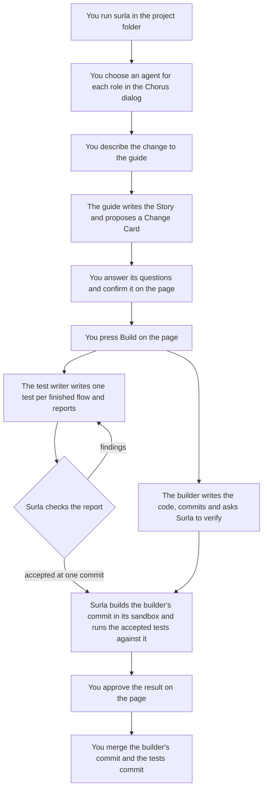

# How Surla Works

**[← Back to README](../README.md)** · **[Golden Path Architecture →](ARCHITECTURE_PLAYBOOK.md)** · **[CLI & MCP Reference →](REFERENCE.md)**

This page follows one change through Surla from the first command to the
merge. For each step it says what you do and see, what each agent does, and
what the server records. The [reference](REFERENCE.md) holds the exact
contract of every command, tool and field.

## Who does what

A change involves you, three coding agents and one server per project folder.
Each has its own credential, so the server always knows who is calling.

| Who or what | What it is | Trusted for |
| --- | --- | --- |
| You, the user | The person who runs `surla` in the project folder. You act on the page in your browser. | The only one who confirms a change, starts a build and approves a result. |
| The guide | The coding agent you talk to about what should change. | Writing the Story (described below) and proposing the change. Surla checks the proposal's shape, not whether it is right: you judge that when you confirm it. |
| The builder | The coding agent that writes the application's code in the project folder. | Nothing on its word: its work counts only when Surla verifies a commit of it. |
| The test writer | The coding agent that writes the tests for a build, in its own working copy of the project. | Nothing on its word: its tests count only when Surla's check accepts them. |
| The server | The project's Surla server. `surla` starts one for each project folder. It keeps the record of what was agreed, built, accepted and approved, and it runs every check. | Deciding, from the files the agents produce, whether work is done. |
| The page | A page in your browser that the server serves; the reference calls it the views page. It talks to the server as you. | Carrying your decisions. No agent has your identity. |
| Herdr | The terminal program the agents and the server run in, one pane per agent. Its core, installed as `herdr-core` with the `hc` command, runs the terminals; the Herdr app shows them. | Running and showing the terminals. |
| Chorus | The messaging service the agents use to talk to each other. It also provides the dialog where you choose which installed agent plays each role. | Conversation only: a message never makes work count as done. |

Four more words appear on every step:

- The **sandbox** is the operating-system sandbox of macOS (`sandbox-exec`),
  in which the server evaluates designs and builds and runs the code the
  agents write for the application.
- A **Story** is a plain description of what the system does, written as Go
  code in the project's design. It names the actors and their **flows**. A flow
  is one path from a starting event to an outcome, for example "a customer
  asks for a refund under the limit and receives store credit". A flow with a
  start, at least one outcome and no open question is **finished**; any other
  flow is a draft. See the [Story language](../story/README.md).
- A **Change Card** is the server's record of one change: your request, the
  guide's analysis of it, the questions only you can answer, your answers and
  the Story it was made from.
- A **`request_revision`** is the digest of one exact version of a Change
  Card. Building, verifying and approving each name it, so none of them can
  apply to a version you did not confirm.

The server decides who may call what from one table. A call by anyone else is
refused with `forbidden` before anything changes. The agents call the server
through an MCP (Model Context Protocol) connection named `surla`. You and the
agents can read the Golden Path, Surla's built-in architecture playbook,
published as the resource `surla://golden-path`.

| Caller | Connects through | What it may do |
| --- | --- | --- |
| You | The page | Confirm a change, adopt or decline a proposed revision, start a build, approve a result, choose the model live targets use, stop a live target, start the agents and bring a pane forward. You read everything the page shows. |
| The guide | Its `surla` MCP connection | Create a starter project, have the Story evaluated, and propose and revise changes. It reads the changes, builds and verification runs. |
| The builder | Its `surla` MCP connection | Read its assignments, generate code, check the project, update its dependencies, run a live target and send prompt drafts to it, and ask the server to verify a commit. It reads the changes, builds and verification runs. |
| The test writer | Its `surla` MCP connection | Read its test assignments and report its tests finished. It reads the build, and the verification runs of the changes it has an assignment for. |
| The `surla` command | The server's management credential | Prepare the team, open the page and stop the server. It makes no decision about the application. |

The reference lists [every operation and who may call it](REFERENCE.md#mcp-tools--resources)
and describes [each operation](REFERENCE.md#mcp-tools).

The roles separate duties; they do not wall the agents off from each other.
All of them run as you, on one machine, and every result that depends on that
says so.

## The journey at a glance



Tool descriptions and the server's terminal name these steps by checkpoint:

| Checkpoint | Step on this page |
| --- | --- |
| `CP1` | [Agreeing on a change](#agreeing-on-a-change) |
| `CP2` | [Previewing the architecture](#previewing-the-architecture) |
| `CP3` | [Trying prompt wording on a live target](#trying-prompt-wording-on-a-live-target) |
| `CP4` | [Verifying the builder's commit](#verifying-the-builders-commit) |
| `CP5` | [Approving and merging](#approving-and-merging) |

Surla deploys nothing and merges nothing. The journey ends with you merging.

## Starting: `surla`, the team and the page

You type `surla` in the project folder. The [README](../README.md#install)
lists what to install first; when Herdr or Chorus is missing, `surla` stops
and prints the command that installs it, or the folder to add to your
`PATH` when the program is installed in `~/.local/bin`.

1. **The server starts.** The first time, `surla` prints `Created a new,
   empty Surla project. Moving or renaming this folder starts a new project.`
   It starts the server in its own Herdr terminal, labelled
   `surla_project=<id>`, and tells it the private state folder it found for
   this project. That folder belongs to your account and lies outside the
   project folder. If a server for this folder already runs, `surla` attaches
   to it instead of starting a second one, when the same build of `surla`
   started it. A server another build started, such as one still running
   after you install a new `surla`, is refused with `this project's server
   was started by another build of surla; run surla stop, then surla`. If the
   server stops while starting, `surla` prints `the project server stopped
   while starting, and its last lines were:` followed by those lines. Nothing
   else was started; fix what they name and run `surla` again.
2. **The team is prepared.** `surla` starts Chorus and the Herdr app if they
   are not running, gives the project a Herdr space (the set of tabs that
   holds the project's terminals) and registers the guide. It prints
   `Team <name>.` and your next step, for example `Choose an agent for each
   role in the open Chorus dialog in Herdr.` If the team cannot be prepared,
   `surla` still opens the page, because confirming and approving need no
   agent, and then prints `the project team is not ready:` with what failed
   and the step that repairs it; **Start agents** on the page tries again.
3. **The page opens.** `surla` opens the page in your browser through a
   single-use link and prints `Surla is running for <folder> at <address>`.
   To open the page again later, run `surla` again in the same folder.
4. **You choose the agents.** The Chorus dialog lists one row per role Surla
   registered. On the first start that is the guide alone. You pick which
   installed agent plays it. The guide's pane opens in the project's Herdr
   space with Surla's first message, which points it to the Golden Path and
   to the project's changes.

The page has one view per task. Changes, Team, Story and Live target are
always there; the others appear once you open a change.

| View | What it is for |
| --- | --- |
| Changes | The project's Change Cards, most recently saved first, each with its latest saved verification run. |
| Team | Each role's pane state, its Chorus watcher and whether it read its assignment, with **Start agents** and an action per role that brings its pane forward, such as **Show guide pane**. |
| Story | The Story of the change shown, and the guide's latest Story draft. |
| Live target | The running copy of your application that the builder tries prompts on, and the model connection it uses. |
| Decisions & Approval | The Change Card: its questions, your answers, confirmation, a proposed revision, the build and the recorded approval. |
| Architecture | The architecture preview of the confirmed card. |
| Proof | The verification runs of the change and the action that approves a passed result. |

A **Traces** drawer shows the server's [operation diagnostics](REFERENCE.md#operation-diagnostics).
The [views page reference](REFERENCE.md#views-page) describes each view in
full. `surla stop` stops the server in order; see
[the `surla` command](REFERENCE.md#surla-serve).

## Agreeing on a change

You type your request in the guide's pane, for example "Customers can get a
refund on an order. Under $50 it is store credit at once; above that a
manager approves it."

1. **The guide writes the Story.** It edits the Story in the project's design
   and calls `refresh_story`, which returns at once while the server
   evaluates the design in its sandbox. `get_story_refresh` then returns the
   Story the server found: actors, finished and draft flows, steps and open
   questions. The Story view shows that draft while the guide works. Where
   the Story starts from depends on the project:
   - A starter project already has a Story, in `design/story.go`, with one
     finished flow, `prices-cookie`, and the test that flow requires. The
     guide adds your flows to that file.
   - In a folder with no service, the guide first creates the starter
     project with `init_project`: a folder inside the project folder holding
     the service, its Story, its test module in `eval/` and a first commit.
     The server then works in that starter folder, and so do the builder and
     the test writer's working copy.
   - In a project made another way, the design can import the Story language
     only when the project's `go.mod` requires its module. When it does not,
     the failed evaluation names the step: in the folder that holds that
     `go.mod`, run `go get github.com/goadesign/surla/story@<version>`, at the
     version Surla's own `go.mod` requires, commit `go.mod` and `go.sum`, then
     try again.
2. **The guide proposes the change.** It calls `propose_change` with your
   request, its analysis and, to include the Story, the Story refresh it
   made. Surla runs no model for this step. It checks the analysis's shape,
   assigns the IDs of its questions and examples, and saves it as a Change
   Card in the project's private state folder, where it waits for you. The
   card appears in the Changes view by itself.
3. **You answer and confirm.** In Decisions & Approval you read the card,
   answer each question and press **Confirm Intent & Lock Examples**. The
   server marks the card `confirmed`, records you as the one who confirmed
   it, and computes its `request_revision`. That revision is the **agreed
   revision**.

A card for the refund request holds, for example:

```text
Change req-refunds · needs confirmation

Examples
  check_01  $35 item ($38.50 total)      → store credit at once, no approval   deterministic
  check_02  $75 item ($82.00 total)      → waits for a manager's approval      deterministic
  check_03  Manager declines a $75 refund → customer sees the reason            model_judged

Questions only you can answer
  req-refunds-ambiguity-01  Does "under $50" mean the item price or the total with tax and shipping?
                            (A $48 item with $6 shipping totals $54.)
  req-refunds-ambiguity-02  At exactly $50.00, store credit or a manager's approval?
```

`deterministic` means code can check the outcome directly; `model_judged`
means checking it needs judgment. Surla cannot tell whether the analysis is
complete or correct. You decide that when you confirm the card.

The guide can revise the change at any time with `revise_change`. Before you
confirm, the revision replaces the card's content and waits for your answers.
After you confirm, it waits beside the agreed revision as a **proposed
revision**; see [Going back](#going-back).

## Previewing the architecture

The Architecture view asks the server for `preview_architecture` on the
confirmed card. The server evaluates the project's design in a sandboxed
process, with no model and no tokens, and shows what the design declares: its
containers and the calls between them, each agent's time and tool-call
limits, and each tool's schemas, including whether a tool declares a
design-time `Confirmation` gate.

The preview does not compare the design with the Change Card. A declared
`Confirmation` gate means the runtime pauses a run for approval before it
calls the tool's method; it does not show that the service delivers the
request to the right person and continues after the answer. The
[`examples/orders`](../examples/orders/README.md) platform implements that
workflow for a manager approving refunds. To read a design without a Change
Card, run `surla preview -dir <module>`.

## Building

You press **Build this change** in Decisions & Approval. Above the button the
page says what starts: "Building starts a builder and, unless this project has
stored verification settings, a test writer whose tests Surla runs on this
machine outside the sandbox to check the builder's work." **Stored
verification settings** name a test suite of your own, an **evaluator**, at
one exact commit; you save them with `surla verification set <file>`, and
they apply when the server starts again. Building always uses the agreed
revision, including while a proposed revision waits.
The reference gives the exact contract of
[builds and assignments](REFERENCE.md#builds-and-assignments).

### What a build adds

1. **The server checks first.** It refuses the start, and saves nothing, when
   the card is not confirmed or the revision is not the agreed one, or when
   the project lacks what a build with a test writer needs: a Git repository
   with at least one commit, the test module `surla init` makes (`eval/` in
   the project folder), a Git name and address, a `.surla-tests` folder and a
   `surla/tests` branch that nothing else uses, macOS for Surla's sandbox,
   and no other build start or test check in progress. Each refusal says
   what is missing and the step to take; the reference lists them under
   [`start_build`](REFERENCE.md#start_build).
2. **The server opens the test writer's working copy** (described below) and
   saves the build: the agreed revision, its Story and its design, and the
   answers, examples and preserved behaviors you confirmed for it.
3. **It registers the builder and the test writer**, each with its own
   credential and folder. The builder works in the project folder; the test
   writer works in its working copy.
4. **It writes the required tests.** For each finished flow of the Story, the
   server generates one required test into the working copy's test module.
   Draft flows require none. The Build section shows the count, for example
   "3 required Story tests."
5. **It brings up the team.** The Chorus dialog opens with rows for the
   builder and the test writer. If it was already open, click **Reload team**
   first. Surla asks for the builder's pane to the right of the guide's and
   the test writer's below the builder's, and gives each Surla's first
   message.

The work belongs to the server. Closing the page does not stop it, and the
page says the start can take a few minutes. Opening the working copy and
writing the tests have a five-minute limit, and bringing up the team its own
45-second limit. Trouble with the Herdr window after the build is saved
leaves the build and the roles in place; press **Start agents** in the Team
view when the window is free.

With stored verification settings, the project verifies with the evaluator
those settings name. Building then adds only the builder, uses no working
copy, and the Build section shows the test writer as "Not used — stored
verification settings". See
[`surla verification`](REFERENCE.md#surla-verification-and-surla-promotion).

### What appears in the project folder

| What | Where | Why |
| --- | --- | --- |
| The test writer's working copy | `.surla-tests/` inside the project folder | A linked Git working copy (`git worktree`) of the whole repository, where the test writer writes its tests. |
| The tests branch | `surla/tests` | The branch checked out in the working copy. Surla reserves the name; it starts at the project's commit, and Surla commits the accepted tests on it. |
| Two lines in the repository's local exclude file | A comment and `.surla-tests/` in `.git/info/exclude` | Keeps the working copy out of `git status`. No tracked file of the project changes. |

The `.surla` prefix makes the builder's `check_project` skip the folder.

When you build again, the server brings a clean working copy to the project's
commit only when your branch already contains `surla/tests`. Otherwise it
keeps the copy as it is and the page records why: the tests are not merged
("Merge the tests branch into the project's branch, then build again"), or
the copy holds uncommitted work.

### The test writer writes the tests

The test writer reads its assignment with `get_test_writer_assignment`: the
working folder, the design and Story as agreed at the built revision, your
answers, examples and preserved behaviors as you confirmed them, and one
required test per finished flow. It may not read the change itself, so the
assignment is how its tests learn what you agreed, and they must hold the
service to it as well as to the Story's flows. It writes the tests inside the
test module, `eval/` in its working copy, and changes nothing outside it. It
never regenerates that module itself, because Surla writes the required
tests into it at the start and again at each report. It checks its work
with `go build ./...` in `eval/`, which fails naming any required method not
yet written.
Then it calls `report_tests_finished`. The report returns at once with the
report's number; the build shows the test writer as **Reported**. In a
starter project the test of the starter's own flow, the method `PricesCookie`
in `eval/acceptance`, is already written and shows the form to follow.

### Surla checks the tests

Surla, not the test writer, decides whether the tests count. Right after each
report, the server checks the working copy without trusting its author (the
reference gives the check's limits under
[judging reports](REFERENCE.md#judging-reports)):

1. It compares the copy's files with the last commit that `surla/tests` and
   the project's branch share, so the test writer's own commits count too.
   Any changed file outside the test module is a finding.
2. It writes the required tests again from the Story saved with the build, so
   the test writer cannot change what is required.
3. It builds the generated test program, `gen/cmd/<name>-evals` in the test
   module, in Surla's build sandbox. A compiler error, such as a missing
   method, is a finding.
4. It runs the program's `--describe` in the sandbox to list the scenarios,
   the named tests, it declares. A required scenario that is missing is a
   finding, and so is a scenario tagged `holdout`, the tag that hides a
   scenario from what the server returns (see
   [hidden scenarios](#verifying-the-builders-commit)).

The verdict replaces **Reported** and marks the test writer's assignment
unread, so it reads it again.

| Verdict on the page | What happened | Who acts |
| --- | --- | --- |
| Needs changes | Surla found problems. The page shows their number; **Read findings** shows their text. | The test writer reads them in its assignment, fixes them and reports again. |
| Accepted | Surla committed exactly the checked files on `surla/tests`, with your Git identity and the message `Add the tests Surla accepted for change <id>, report <n>`. The build details show that commit. The builder's assignment is marked unread too. | The builder can verify. |
| Could not run | The check stopped for a cause the test writer cannot fix, such as a time limit, Git trouble, a sandbox that could not start, or dependencies that cannot be downloaded where Surla runs. The page shows the reason and your step. | You take the step; it says whether the test writer then reports again or you build again. |

An acceptance always carries the same sentence, which the page shows: "Surla
checked that these tests build into the generated test program and declare
every required scenario; it did not judge what they assert." Whether the
tests check the right things is still yours to judge.

## Trying prompt wording on a live target

When the application calls an AI model, the builder can try prompt wording
before committing it. It calls `start_live_target` with a commit. The server
builds that commit in its sandbox and starts it as the **live target**: a
running copy of your application that only Surla started. Surla never
changes prompts in an application you started or deployed. Without stored
verification settings, the commit's own test module starts the copy, so the
commit needs the test layout `surla init` makes but no accepted tests.

The builder then calls `draft_override`. A prompt template change
(`target_kind: "prompt_template"`) goes to the live target in memory, without
rebuilding, and the result returns the version in force. A change to a
compiled business rule (`target_kind: "compiled_rule"`, such as the $50
limit) changes nothing: the result says `requires_rebuild: true`, because the
rule needs a Go rebuild and verification, so a hard rule never moves into
prompt text. A draft lasts as long as the live target: to keep wording, the
builder edits it into the prompt's source and commits it.

In the Live target view you see the target's state and commit, the prompts it
changed (never their text), and **Stop live target**. Under **Model
connection** you choose the model that live targets started afterwards use: a
provider and model name, whose key must be in the server's environment, or a
running model gateway. The server runs in a Herdr terminal, which has the
environment of the Herdr core rather than of the shell where you typed
`surla`. See the [live target prompt contract](REFERENCE.md#live-target-prompt-contract).

## Verifying the builder's commit

The builder commits its code and calls `verify_change` with the change, the
revision from its assignment and its commit. Without stored verification
settings, the server refuses before running anything when the revision has no
build (`no_build`), when the build's tests are not accepted
(`tests_not_accepted`, naming the test writer's state), or when a commit lacks
the test layout (`no_test_layout`). Each refusal names who acts next; see
[`verify_change`](REFERENCE.md#verify_change).

An accepted call returns a run ID at once. The run happens in its own
**run directory**: a folder the server keeps outside the project, holding the
run's request, its lock, its result and its logs. The run continues when the
builder disconnects or the server restarts. It:

1. checks out the builder's commit and builds the application in Surla's
   macOS sandbox, which lets a build write only its own folders;
2. takes the accepted tests at the exact commit Surla recorded for this
   build, and builds their generated test program;
3. runs that program, which starts each of the builder's programs in its own
   sandbox, with access only to the local ports the run assigns.

The test program itself runs outside the sandbox: it starts the builder's
programs in their own sandboxes, and macOS does not nest one sandbox inside
another. It starts with only `PATH` and a temporary folder in its
environment: no model key and nothing else of yours. Surla's test layout
plans with a scripted model during verification.

Every run records where its tests came from. For tests the test writer wrote,
the run's result, as `verify_change`, `get_verification` and
`list_verifications` return it, names the tests commit and carries this
notice: "These tests were written by a separate agent on this machine and are
not isolated from the builder." The Proof view lists the change's saved runs
and shows the selected run's scenarios and outcome. For a run of the test
writer's tests it shows that notice with the result. Under **Candidate and
run details** it shows the builder's commit as "Candidate commit" and the
tests commit as "Accepted tests commit", or as "Evaluator commit" when the
run used the evaluator that stored verification settings name.

The Changes view shows each change's latest saved run, for example "Latest
saved run: passed", and says under it whether that run counts for the change
as it stands. "Matches the agreed revision and selected tests." means the run
verified the agreed revision with the tests a run of that revision would
use: the tests accepted for the build of that revision or, with stored
verification settings, the evaluator they name. Otherwise the line reads
"Earlier inputs or no current test selection." and tells you to ask the
builder for a run of the agreed revision. A run that does not match stays
readable in the Proof view.

The server returns only the builder view of a report, to you and to the
agents alike. An evaluator named in stored verification settings can declare
**hidden scenarios**: scenarios tagged `holdout`, whose names, checks and logs
never appear in what the server returns; the builder view shows only an
anonymous outcome such as `holdout-1`. The test writer's tests cannot be
hidden, because Surla's check refuses the tag.

With stored verification settings, a run uses the evaluator those settings
name and needs no build. Outside the journey, the
[`surla verify`](REFERENCE.md#surla-verify) command runs one verification from
the command line.

## Approving and merging

When a run passed, the Proof view offers **Approve this result**. Only you
can approve. The server reloads the run's report and derives it again from
its evidence, checks that it passed and that it verified the agreed revision
with the tests accepted for that revision, and records the approval on the
Change Card: the builder's commit, the tests commit and the report. Approval
merges and deploys nothing.

The approval names two commits: the builder's commit that the run verified,
and the tests commit that Surla accepted for the revision. The recorded
approval lists them under **Verified inputs and digests** as **Builder's
commit** and **Tests' commit**. For the test writer's tests you merge both,
and the page follows the server's notice with "merge commit <tests commit>
(on branch surla/tests)". With stored verification settings the tests commit
is the evaluator's, and you merge only the builder's commit. Approval is
refused when the run used other tests than the ones accepted for the
revision; the builder then verifies again and you approve that run. A
recorded approval stays shown only while the same tests commit is the
accepted one: after another report or another build, it reappears only if
Surla accepts that same commit again.

Approval needs no settings. A project can store promotion settings with
`surla promotion set <file>`: a release folder, where your own release step
publishes the builder's binaries for each commit, and the binaries' names.
Like verification settings, they apply when the server starts again.
Approval then makes one more check: the files in the release folder must be
the binaries the run built. When one is missing or differs, approval is
refused, and the refusal ends with your step: "publish the binaries the run
built into the release folder that the promotion settings name, in a folder
named after the commit, or remove the promotion settings". See
[`surla promotion`](REFERENCE.md#surla-verification-and-surla-promotion) and
[`approve_merge`](REFERENCE.md#approve_merge).

A change to the agreed revision drops its approval; see
[Going back](#going-back).

## When an agent needs you

Agents stop at questions and permission prompts. The server follows each
registered role's pane in Herdr and shows, on every view of the page, one line
per role that waits for you, for example "Builder needs you: permission",
with a **Show builder pane** action that brings that pane forward. You answer
in the pane.

The Team view shows each role's pane state (Not started, Starting, Working,
Waiting, Needs you, Ended, Error or Status unknown), whether its Chorus
watcher (the agent's background wait for messages) is held, and whether it
owes an assignment read. **Start agents**
opens the Chorus dialog for roles that are not running. What the server cannot
observe stays "unknown"; it never guesses. Surla never types into an agent's
pane. See [team supervision](REFERENCE.md#team-supervision).

## Going back

Any step can be taken again on the same change. The server always says which
revision a build, a run or an approval belongs to.

| What happens | What stays valid | What must be redone |
| --- | --- | --- |
| The guide revises a confirmed change | The agreed revision stays in force with its answers, build, runs and approval. The page shows the proposed revision beside it, under "Waiting for you". Refining the agreed revision is blocked until you adopt or decline. | Nothing until you decide. |
| You decline the proposed revision | Everything, exactly as it was. | Nothing. |
| You adopt the proposed revision (answer its questions, then **Adopt this revision**) | Earlier runs stay readable for their revision. | The adopted revision has another `request_revision` and no approval. The build becomes "Built for an earlier revision" and the builder's `verify_change` for the old revision is refused: build again. |
| You change answers or examples of the agreed revision (**Refine Confirmed Answers & Examples**) | A submit with no change keeps everything. | A change gives another `request_revision`, drops the approval, and needs a build of that revision. |
| You build the same revision again (**Build again…**, which asks first) | The agreed revision. | Both assignments become unread, the test writer's work returns to Assigned without report or verdict, and its tests must be reported, checked and accepted again before verification. |
| The test writer reports again | The build. | Its earlier verdict is cleared; Surla checks the report again. |
| Surla says the tests branch and the project share no history | Commits you already merged. | Run `git worktree remove .surla-tests` and `git branch -D surla/tests` in the project folder, then build again. |

When the agreed revision has a build, the page says what adopting or refining
does to it, above **Adopt this revision** and, once you have edited an answer
or an example, above **Refine Confirmed Answers & Examples**: the build stays
on the earlier revision, and a build of the changed revision replaces both
assignments and clears the test writer's report and verdict, so its tests
must be reported, checked and accepted again before verification. With stored
verification settings it says instead that a build of the changed revision
updates the builder's assignment and that verification keeps using those
settings.

Building a revision you have just adopted or confirmed does not ask first.
Each assignment stays as it was, for its revision, until you build again.
