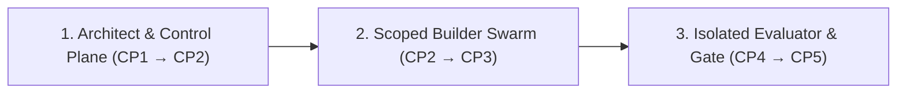

# How Surla Works: The 5 Checkpoints & Isolated Verification

**[← Back to README](../README.md)** · **[Golden Path Architecture →](ARCHITECTURE_PLAYBOOK.md)** · **[CLI & MCP Reference →](REFERENCE.md)**

Surla replaces blind trust in agent-generated diffs with a chain of evidence from **natural-language intent → compiled Goa contract → scoped multi-model construction → OS-isolated verification**.

When your request is already unambiguous, `propose_change` confirms the Change Card itself, so you can go straight to the Checkpoint 2 architecture preview.

---

## Overview: Three Roles, Strict Separation of Powers

Surla plans every change around three distinct roles so the agent that writes the code never defines the contract alone or grades its own output. Surla proposes the team; the builders themselves are your coding agents:



1. **📐 Architect & Control Plane (`CP1` → `CP2`) — Intent Lock, Compiled Contract & Swarm Plan**
   - Scaffolds a new Goa + Goa-AI starter project over MCP with `init_project` (`POST /workspace/init`) inside `<workspace>/<dir>`, transitioning a running `surla serve` workspace in place without restarting, and surfaces concrete input/outcome examples and open domain questions at `CP1`, freezing a SHA-256 `request_revision` digest once you confirm.
   - Evaluates `design/*.go` inside a sandboxed subprocess at `CP2` (`0` LLM tokens) to extract the C4 topology, tool schemas, and security guardrails (automatically reading `design/*.go` and `DesignSnapshot` from the bound workspace when `design_source` or `design` is omitted), and—when server-configured provider profiles (`-swarm-profiles`) and explicit builder path scopes (`builders`) are supplied—proposes a Chorus roster sized to the requested scopes (`@builder-<scope>` and `@reviewer` by default, plus optional `@architect` when `architect_paths` are supplied and `@eval-author` when `eval_paths` are supplied) across distinct model families.
2. **🛠️ Scoped Builder Swarm (`CP2` → `CP3`) — Golden Path Implementation & Fast Draft Mode**
   - Builders read `surla://golden-path` and generated `AGENTS_QUICKSTART.md`. Because `goa gen` writes all HTTP/gRPC/MCP/OpenAPI plumbing, builders implement only domain and Temporal workflow packages within their owned paths. After editing a local design, `generate_code` regenerates the active application's code over MCP; `target: "eval"` regenerates its public local `eval/` module instead. Builders can edit and regenerate repeatedly on the same server, then build the application and run tests before verification.
   - In `CP3`, `draft_override` updates prompt templates in memory, without rebuilding Go code, on the live target `start_live_target` runs (a `candidate_commit` built as `CP4` builds it and started by the evaluator suite's `--live` mode), or through `Options.TargetUpdater` when a host program binds one (such as [`examples/orders/cmd/orders-surla`](../examples/orders/cmd/orders-surla/main.go); see the [`draft_override` reference](REFERENCE.md#mcp-tools)), while refusing to override compiled Go business rules (`compiled_rule`). A runtime override is never what `CP4` verifies: to keep drafted text, edit it into the prompt's source, commit, and verify that commit for the same `request_revision`. You can test **Customer** vs. **Approving Manager** flows against the candidate API and stateful simulators.
3. **🛡️ Isolated Evaluator & Gate (`CP4` → `CP5`) — Sandboxed Verification, Crash & Budget Proof**
   - `verify.Run` checks out exact `CandidateCommit` and `SuiteCommit` SHAs, builds the candidate binaries inside a macOS `sandbox-exec` jail (`candidate.Build`), and runs the trusted evaluator suite against them—exposed on the CLI as `surla verify` and on the control plane as `verify_change` (`POST /changes/{change_id}/verifications`), `get_verification` (`GET /verifications/{run_id}`), and `list_verifications` (`GET /changes/{change_id}/verifications`; see [`docs/REFERENCE.md`](REFERENCE.md#mcp-tools)), which run and inspect each verification in a detached supervised process group (`internal/verifyrun`) that survives `surla serve` restarts (resolving a committed starter workspace's layout and suite `HEAD` commit automatically when `-verification-config` is omitted). The suite starts each candidate process in its own sandbox (`candidate.Exec`); in the `examples/orders-eval` reference suite, candidate LLM calls also go through the evaluator's gRPC model gateway.
   - Redacts unseen **holdout scenarios** from builder reports (`Report.ForBuilders()`) and re-derives the report from raw evidence to verify `CandidateCommit`, `RequestRevision`, `SuiteID`, `SuiteCommit`, candidate binary `Artifacts` digests, and `Environment` in `verify.Approve`—exposed on the CLI as `surla approve` (which checks a saved report file against explicit flags without recording a card approval) and on the control plane as `approve_merge` (`POST /changes/approve`, which loads the report and current promotion inputs from `Options.PromotionTarget` and saves the recorded approval on `ChangeCardResult.approval` in `Options.CardsDir` for the card's bearer principal without merging or deploying).

---

## Checkpoint 1 (`CP1`): Confirm What Surla Understood

When you call `propose_change`, Surla analyzes your feature request against the current `design/*.go` using the embedded Golden Path system prompt (`goldenpath.ArchitectSystemPrompt`) and produces a structured **Change Card**:

```text
Surla · Here's What I Understood (change_id: req-refunds, status: needs_confirmation)
───────────────────────────────────────────────────────────────────────────────────────
Examples (each maps to an isolated evaluator check):
  ✓ check_01  $35 item ($38.50 total)     → Instant store credit, no approval [deterministic]
  ✓ check_02  $75 item ($82.00 total)     → Waits for manager approval        [deterministic]
  ✓ check_03  Manager declines $75 refund → Customer sees reason + support    [model_judged]

Open questions to settle before building:
  ? req-refunds-ambiguity-01  Does "under $50" mean item subtotal or total with tax & shipping?
                              (e.g., $48 item + $6 shipping = $54)
  ? req-refunds-ambiguity-02  What happens at exactly $50.00 — instant credit or manager approval?
```

- **Server-assigned IDs & strict schema validation**: The control plane validates structured model output with `DisallowUnknownFields`, assigns deterministic `<change_id>-ambiguity-NN` and default `check_01`, `check_02`, ... IDs (matching `goa-ai/eval` `validateID`) in Go code, and rejects malformed responses.
- **Durable on-disk Change Card store (`Options.CardsDir` / `-cards-dir`)**: `controlplane.New(opts)` opens `opts.CardsDir` (on `surla serve`, `<UserConfigDir>/surla/operator/project-<sha256(real_workspace)>/cards-<sha256(startup_cwd\0real_workspace)>` by default when `-cards-dir` is omitted and `<startup_cwd>/.surla/cards` lies inside the workspace, `<startup_cwd>/.surla/cards` when that directory already lies outside the workspace, or the explicit `-cards-dir` path), acquires an exclusive non-blocking `flock` on `<cards_dir>/lock` held until `(*ControlPlane).Close()`, and saves each card (`card`, `owner`, `design_source`, and optional `source_origin`) as `<cards_dir>/<sha256(change_id)>.json` via a synced staging file, atomic rename, and directory `fsync`. Every read decodes the file with `DisallowUnknownFields`, rejects trailing tokens, and verifies that the card's `request_revision` matches `computeCanonicalRevision(card, owner, design_source)` so Change Cards survive `surla serve` restarts without an in-memory cache.
- **Revision lock & iterative refinement (`revise_change`, `confirm_intent`, `get_change`, & `approve_merge`)**: Answering the open questions transitions the card to `confirmed` and computes a canonical SHA-256 `request_revision` digest. When requirements or scope change on an existing `change_id`, calling `revise_change` (`POST /changes/revise`) with its current `request_revision` and a revised `prompt` (and optional `design_source`) runs `goldenpath.ArchitectReviseSystemPrompt` over a `CP1PriorCard` snapshot of the saved card (preserving prior example IDs), which gives the model the earlier prompt, confirmed answers, open questions, summary, examples, and preserved behaviors as context for the revised analysis. The model accounts for every prior example via `prior_id` or `removed_example_ids`: surviving and edited prior examples keep their IDs, IDs from the immediately prior table (including removed IDs) are reserved while constructing the current revision, and brand-new examples receive the lowest unused `check_NN` ID absent from the prior and resulting tables. It resets `status` to `needs_confirmation` (even when `0` open ambiguities remain) and clears `answers`, `confirmed_by`, and `approval`, because the revision's questions are newly analyzed and can differ from the earlier ones; the caller checks that the earlier decisions appear in the returned `summary`, `examples`, and `preserved_behaviors`, answers the current `ambiguities`, and calls `confirm_intent` with the new `request_revision`. `revise_change` also re-binds any new `ui_composition` and saves the updated card at its new canonical `request_revision`. Calling `confirm_intent` again on a `confirmed` card with its current `request_revision` refines the locked answers or examples (returning the stored card on a no-op submit and minting a new `request_revision` when answers or examples change, which invalidates stale downstream previews, verification reports, and any recorded `approval`). If another editor updates the card first, `get_change` (`GET /changes/{change_id}`) fetches the latest saved `ChangeCardResult`. Whenever `get_change` or a no-op `confirm_intent` reads a card with a recorded `approval`, it checks `PromotionTarget.CurrentInputs` for `approval.candidate_commit`: it returns `approval` (and `unverified_approval: nil`) only when `Options.PromotionTarget` is bound and the current `SuiteID`, `SuiteCommit`, `Environment`, and `Artifacts` still match; it omits both `approval` and `unverified_approval` on a shallow response copy when `CurrentInputs` succeeds with different inputs (without mutating the saved card or `request_revision`); and when `Options.PromotionTarget` is nil or `CurrentInputs` returns an error, it omits `approval` and populates `unverified_approval` (`UnverifiedApprovalItem`, carrying the recorded approval metadata and a path-free operator recovery `reason`, while recording the raw `CurrentInputs` error on the `controlplane.check_approval` span) rather than failing the card read. `preview_architecture` and `approve_merge` reject a `request_revision` that is not the card's current one. `surla verify` records the `-request-revision` you pass in its report, and `surla approve` (`verify.Approve`) compares a saved report file with the explicit binding flags its caller supplies without looking up a stored card.

---

## Checkpoint 2 (`CP2`): Review the Compiled Contract & Multi-Model Swarm

Calling `preview_architecture` against a confirmed Change Card stages the candidate `DesignSnapshot` inside an isolated subprocess, runs Goa, Goa-AI, and `goa.design/model` evaluation, and returns the bound architecture preview and proposed swarm plan (for local read-only design inspection without a Change Card, `request_revision`, `design_digest`, or `swarm` plan, run `surla preview -dir <module>` on the CLI to print the raw `designeval.Result`):

```text
Surla · Contract & Build Plan (Request rev #2, Design digest sha256:4f8a...)
───────────────────────────────────────────────────────────────────────────────────────
Scope:    1 edge service (orders), 2 internal services (commerce, payments), 1 agent (refund)
Contract: orders.issue_store_credit & orders.request_refund
          • tenant_id & customer_id injected server-side (omitted from LLM schema)
          • BoundedResult pagination on orders.list_orders & orders.continue_orders
          • Design-time Confirmation gate on orders.request_refund
Swarm:    @architect (Claude) · @builder-orders (Claude) · @eval-author (Gemini) · @reviewer (Codex)
          • cross_family_review: true · cross_family_eval: true
```

Apart from the proposed swarm, the preview reports what the design declares: its containers and the calls between them, each agent's time and tool-call limits, and each tool's schemas, including whether it declares a design-time `Confirmation` gate. It does not compare the design with the Change Card's requirements. A declared `Confirmation` gate means the runtime pauses the run for approval before executing the bound tool method (so the bound method's own authorization has not run yet); it does not show that the service delivers that request to the right person and continues after the answer. The host can inspect the pending call's payload when handling the suspension and answer `Approved: false` immediately when the caller is not authorized to request the action, or implement and verify the full approval workflow in application code, as [`examples/orders`](../examples/orders/README.md) does for a manager approving refunds.

### How Cross-Family Chorus Routing Works (`internal/swarm`)
When coding-agent provider profiles are configured on the server (`Options.SwarmProfiles` / `-swarm-profiles`) and the caller supplies explicit `builders` path scopes, Surla's planner (`swarm.Plan`) deterministically assigns roles sized to the requested scopes:
1. **Progressive Roster Sizing & Explicit Scopes**: When `builders` is omitted, `swarm.Plan` returns a solo preview (`status: "unconfigured"`, `missing_roles` omitted; passing `architect_paths` or `eval_paths` without `builders` is rejected). When `builders` is supplied, Surla assigns `@builder-<scope>` (`read_write_worktree` per scope) and `@reviewer` (`read_only_review`), and includes `@architect` (`read_only_after_cp2`) only when `architect_paths` (`-architect-path`) is supplied and `@eval-author` (`isolated_eval_workspace`) only when `eval_paths` (`-eval-path`) is supplied—without inventing default path globs.
2. **Disjoint Reviewer & Eval-Author Families**: Surla resolves pinned builders first and scores candidate default model families against the union of pinned and unpinned builder families so `@reviewer` (and `@eval-author`, when requested) use model families disjoint from every builder whenever configured profiles (`Authenticated: true`) allow.
3. **Honest Posture & Isolation Reporting**: If only one model family is configured—or if pinned builders span all available families—Surla reports `cross_family_review: false` or `single_family: true` rather than claiming cross-family diversity that did not happen, and when `@eval-author` is not requested, Surla reports `cross_family_eval: false` with `"eval-author not assigned in this roster"`. Owned paths and access modes in the roster are operator-declared Chorus coordination boundaries (unverified by Surla, not secrecy or OS isolation): an in-repo starter suite (`eval/**`) is readable by builders, while unseen holdouts require an external evaluator workspace inaccessible to builders, and at `CP4` `verify.Run` sandboxes candidate builds and processes inside `verify/candidate` while executing the trusted evaluator binary on the host.
4. **Chorus Collaboration Manifest**: `swarm.FormatManifest` emits a compact coordination manifest (change and design digest, cross-family status, boundary note, and each role's handle, profile, model, family, access mode, and owned paths) that an orchestrator can pin in a [Chorus](https://github.com/goadesign/chorus) channel. Surla returns it; it does not launch agents, prepare Git worktrees, or publish the manifest.

---

## Checkpoint 3 (`CP3`): Fast Draft Overrides & Live Sandbox Walkthrough

At `CP3`, Surla separates in-memory prompt tuning from compiled business rules and pairs the candidate service with stateful dependency simulators (`examples/orders-eval/sim`).

> **Current implementation vs. target CP3 UI:** Today, `internal/controlplane` serves the `draft_override` MCP tool (`POST /sandbox/draft`), which applies `prompt_template` updates to the live target `start_live_target` runs on `surla serve` (with `-project` or `-verification-config`) or through `Options.TargetUpdater` when an embedding host binds one, and rejects them when neither is bound. It also serves the stateless `ui://surla/checkpoint` MCP Apps viewer through MCP `resources/read` (`POST /mcp`; `GET /ui/checkpoint` returns the HTML document as a JSON-encoded string). The viewer completes the `ui/initialize` → `ui/notifications/initialized` handshake with its host, retains received session checkpoints with a top navigation bar and backward-loop actions (`View Saved Verifications`, `Load Change Card`, and `Return to Change Card`) that preserve unsaved CP1 draft edits, and renders each tool result: the CP1 Change Card form (`confirm_intent` and `get_change` through host `tools/call`), the optional CP1 OpenUI decision view, CP2 architecture previews (a keyboard-focusable scrollable C4 graph region above inspectable lists, an expandable `#surla-cp2-swarm-manifest` Chorus manifest, a notice indicating that previews are session-only and not stored on the server, and warnings when the preview applies to a different revision or Change Card than the loaded card), structural diffs, CP3 live-target and fast-draft results (rendering both retained CP3 views together when both are active in the session), and CP4 verification runs (`verify_change`, `get_verification`, and `list_verifications`; see [`docs/REFERENCE.md`](REFERENCE.md#mcp-tools)), including card-scoped saved-run lookup, a `Check status` action and `aria-busy="true"` on `#surla-cp4-verification` while a read is in flight, warnings when the displayed run applies to a different revision or Change Card than the loaded card, and a status notice when the displayed run is not included in the last loaded list. Role-switched Customer vs. Approving Manager flows run directly against the candidate HTTP API in [`examples/orders`](../examples/orders/README.md) and [`examples/orders-eval`](../examples/orders-eval/). The role-switcher dropdown, one-click scenario replay buttons, `+ Make This an Example` capture, and `openui.v1` action dispatch shown below are the target CP3 design (`PROPOSAL.md` §5.3), not shipped controls.

```text
Surla Sandbox · Candidate 3a506f6 · [ENV: SIMULATED PAYMENTS — NO REAL MONEY MOVES]
Role: [Customer ▾] (Switch to [Approving Manager] to approve/decline paused refunds)
───────────────────────────────────────────────────────────────────────────────────────
One-click replay of your confirmed examples:
  [▶ Replay: $48 + $6 shipping ($54) → Waits for manager]
  [▶ Replay: $50.00 total            → Instant store credit]
  [▶ Replay: $75 declined by manager → Customer explanation]
Or type any prompt to poke the agent live...        [+ Make This an Example] [⚡ Draft Tweak]
```

- **Role Switching Against Real Auth Boundaries**: Trigger a `\$54.00` refund as a **Customer**, verify that a `Customer` bearer token receives `403 Forbidden` if it calls the manager approval endpoint (`POST /runs/{run_id}/approval`), and switch to **Approving Manager** to approve or decline the paused workflow run via the public API.
- **CP1 Decision Studio (`ui://surla/checkpoint`)**: Every Surla tool declares `ToolUI("ui://surla/checkpoint")`. When `propose_change` or `revise_change` returns a `ui_composition`, the viewer renders it with the OpenUI decision catalog (`DecisionWorkspace`, `PolicySimulatorTable`, `PolicySimulatorRow`, `AmbiguityChoiceCard`, `WorkflowTimeline`, `WorkflowStep`, `ImpactCallout`). Its choice controls edit the same CP1 draft (`CP1DraftContext`) as the form. The workspace carries a `Model-Proposed Illustration` badge and a notice when you edit examples locally. When a Change Card transitions to a new revision for the same `change_id`, the viewer displays the previous saved revision in `#surla-prior-revision`; when a new revision arrives while you have unsaved edits, switching to the incoming card (`#surla-replace-incoming-card`) preserves only your changed draft answers (with ambiguity question text) and changed examples in `#surla-preserved-draft` alongside the new card. When a confirmed card carries a current `approval` from `approve_merge`, the viewer renders the `#surla-cp5-approval` panel describing that verified check on the saved Change Card (with full commit, report, suite, and binary SHA-256 digests under expandable `Verified inputs and digests` details) and warns when unsaved draft edits would mint a new `request_revision` and clear that approval; when a saved approval cannot currently be verified against `PromotionTarget` (`unverified_approval`), the viewer renders `#surla-cp5-unverified-approval` with the recovery reason, recorded approval details, and a `#surla-cp5-refresh-approval` action, and refreshes any retained editor card via `get_change` after an applied `CP3` override without losing unsaved draft edits. `validateCompletedOpenUI` rejects compositions for another revision, components in the wrong slot, and props outside the catalog schemas, and the full form stays usable when it does. The published `@openuidev/lang-core@1.0.2` parser still silently skips bare lines and same-line trailing tokens; `validateCompletedOpenUI` already rejects programs whose `meta.discarded` is non-empty, which takes effect once a release with [thesysdev/openui#1525](https://github.com/thesysdev/openui/pull/1525) is selected.
- **Fast Draft Mode (`draft_override`)**:
  - Editing a **prompt template** (`target_kind: "prompt_template"`) sends the text to the live target `start_live_target` runs, or invokes `Options.TargetUpdater` when a host program binds one (both described in the [`draft_override` reference](REFERENCE.md#mcp-tools); with neither, `surla serve` rejects it) to update the target platform's `prompt.Store` in memory, without rebuilding Go code, and returns the new `prompt_version` digest. On the target side, [`examples/orders`](../examples/orders/) wires a process-owned `prompt.NewInMemoryStore()` via `runtime.WithPromptStore` and exposes `override_prompt` (`PUT /prompts/{prompt_id}`, requiring the `prompts:manage` JWT scope): it validates the template before saving it, returns the accepted text's `sha256:...` version (`prompt.VersionFromTemplate`), and applies it on the next turn planned by that `orders` process (while a newly started `orders` process begins with its generated built-in `sha256:...` baseline prompt and other running `orders` processes keep their own prompts). `surla serve` never binds `Options.TargetUpdater`; it applies `prompt_template` edits only to a live target started with `start_live_target`; [`examples/orders/cmd/orders-surla`](../examples/orders/cmd/orders-surla/main.go) provides a separate reference `CP3` host (consuming the pinned `github.com/goadesign/surla` version in `examples/orders/go.mod`, saving cards in `-cards-dir`, default `.surla/orders-surla-cards`, with `SURLA_AUTH_TOKEN` authenticating MCP callers and `ORDERS_PROMPTS_TOKEN` granting `prompts:manage` on the target) that binds `TargetUpdater` to `override_prompt` while leaving `CP1` analysis, `CP4` verification, and `CP5` promotion unconfigured.
  - Attempting to override a **compiled business rule** (`target_kind: "compiled_rule"`, such as the `\$50.00` limit) is rejected (`requires_rebuild: true`) so hard domain invariants never drift into unverified prompt text.

---

## Checkpoints 4 & 5 (`CP4` & `CP5`): OS-Isolated Verification & Merge Gate

When verification runs via `surla verify` on the CLI or `verify_change` (`POST /changes/{change_id}/verifications`), `get_verification` (`GET /verifications/{run_id}`), and `list_verifications` (`GET /changes/{change_id}/verifications`; see [`docs/REFERENCE.md`](REFERENCE.md#mcp-tools)) over MCP/HTTP (`internal/verify` `verify.Run` and `internal/verifyrun`, exercised end-to-end by `go test -race -tags e2e ./internal/verify` and `(cd examples/orders-eval && go test -race -tags e2e ./acceptance)`), Surla never trusts the builder's working directory or test output:

```text
Surla Evaluator Report · Candidate 3a506f6 (OS Sandbox: macOS sandbox-exec)
───────────────────────────────────────────────────────────────────────────────────────
Status: passed (5/5 scenarios passed · 1 unseen holdout scenario verified)

Confirmed Examples & Resilience Checks:
  ✓ store_credit_within_limit              $38.50 total → store credit, no manager
  ✓ card_refund_needs_manager              $54.00 total → waits; only that tenant's manager approves → 1 card refund
  ✓ refund_survives_worker_crash           worker killed (kill -9) after payment → 1 refund on replay
  ✓ pending_approval_survives_api_restart  API killed and restarted while waiting → approval → 1 card refund
  ✓ other_customers_order_refused          [HOLDOUT] another customer's order → no refund

Token & Cost Gate (via Evaluator Model Gateway):
  ✓ Measured usage within scenario budgets · 0 incomplete usage records
```

### Why the Builder Cannot Game the Evaluator
1. **OS Process & Filesystem Sandbox (`verify/candidate` & `verify/suite`)**: On macOS, candidate builds (`candidate.Build`, run by `verify.Run`) and candidate server/worker processes (`candidate.Exec`, started by the evaluator suite after `suite.Main` pins each `--artifact` binary with `candidate.Pin`) run under a strict `sandbox-exec` Seatbelt profile. They can write only to their temporary build/state directories and bind or connect only to evaluator-assigned `127.0.0.1` ports. `candidate.BuildTest` compiles one candidate package's `_test.go` files into a single test binary under the same build profile (`go test -c -trimpath -vet=off`), returning `false` without writing a test binary when the package has no tests. Its contract requires the caller to run that binary only through `candidate.Pin` and `candidate.Exec`. There, the test runs with `StateDir` as its working directory, so a package's `testdata/` is present only if the caller copies it in; a test that starts a child process fails with `operation not permitted`, and listening or connecting outside its assigned ports is denied. No Surla command builds or runs candidate tests today. Each scenario attaches `pinned.Evidence("<name>")` so the verifier can compare the suite-reported binary digests with the bound digests (actual process execution remains the trusted evaluator suite's responsibility).
2. **Evaluator-Owned Contracts & Simulators**: In the [`examples/orders-eval`](../examples/orders-eval/) reference suite, the evaluator binary is compiled from its own commit (`SuiteCommit`) with its own copy of the generated contracts and stateful commerce/payment simulators.
3. **Gateway-Enforced Token & Cost Accounting**: Every LLM call the candidate makes in `examples/orders-eval` traverses a `goa-ai` gRPC model gateway hosted by the evaluator. If a change bloats tool payloads (`TestSeededPayloadBloatFailsTheBudget`, raising an order page from `10` to `50` items) or makes a call whose usage the gateway cannot fully account for (counted in the evaluator's `Usage.Unreported`), the scenario fails even if functional assertions pass.
4. **Redacted Holdout View (`Report.ForBuilders()`)**: Builders receive a `BuilderReport` (`Report.ForBuilders()`) showing only anonymous holdout outcomes (`holdout-1`)—never the holdout scenario names, declarations, checks, or failure logs.
5. **Merge-Gate Check (`verify.Approve`, `surla approve`, and `approve_merge`)**: `verify.Approve` re-derives the entire `verify.Report` from its `Binding`, `Suite`, and raw `eval.Report` `Evidence` and verifies that `CandidateCommit`, `RequestRevision`, `SuiteID`, `SuiteCommit`, candidate binary `Artifacts` SHA-256 digests, and `Environment` match the change being promoted before approving. On the CLI, `surla approve` decodes a saved report file (`verify.DecodeReport`) and checks it against explicit promotion flags, printing a JSON summary (`report_digest`, `binding`, `counts`) on success without contacting a server or saving card state. On the control plane, `approve_merge` (`POST /changes/approve`) loads the report by `report_digest` and the current `PromotionInputs` for `candidate_commit` from `controlplane.Options.PromotionTarget`, checks them with `verify.Approve` against the owner's confirmed `request_revision`, and saves the updated card with `approval` (`ChangeCardResult.approval`) in `Options.CardsDir` for the authenticated bearer principal (replacing any prior approval on that revision) without merging branches or deploying binaries (`surla serve -promotion-config <path.json>` binds a staged-release `PromotionTarget` that loads reports from `report_dir` and hashes each configured regular-file binary inside an atomically published `<release_dir>/<candidate_commit>/` directory through a single `os.OpenRoot` handle, approving those staged binaries for a fresh launch with the evaluator suite's fixed configuration without claiming anything about already running processes; omitting `-promotion-config` leaves `PromotionTarget` unbound and rejects `approve_merge`). Whenever `get_change` or a no-op `confirm_intent` reads a saved card with a recorded `approval`, it re-checks `PromotionTarget.CurrentInputs(ctx, approval.CandidateCommit)` (rehashing the staged binaries on `-promotion-config`): it omits both `approval` and `unverified_approval` when the target's suite, environment, or staged binary digests have changed (leaving the saved card on disk unchanged), and returns `unverified_approval` (omitting `approval`, with a path-free operator recovery reason) when `PromotionTarget` is nil or `CurrentInputs` returns an error (such as missing staged binaries or an embedding host whose live target runs unverified runtime overrides outside the fixed-input precondition in [`internal/verify/report.go`](../internal/verify/report.go)).
