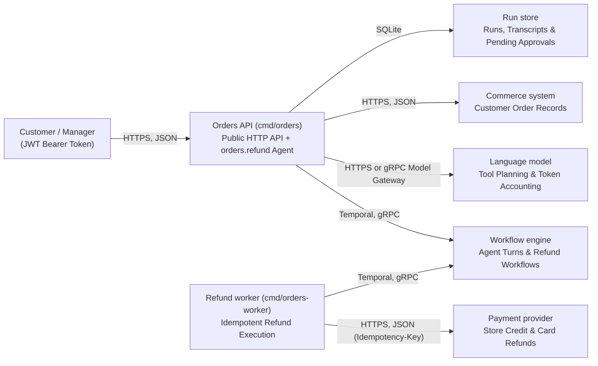

# Orders Reference Platform (`examples/orders`)

**[← Back to Surla README](../../README.md)** · **[Agent Quickstart (`AGENTS_QUICKSTART.md`)](AGENTS_QUICKSTART.md)** · **[Isolated Acceptance Suite (`../orders-eval`)](../orders-eval/acceptance/acceptance_test.go)**

`examples/orders` is a complete, Golden Path Goa-AI platform that demonstrates why teams build on Surla:

1. **0-token transport & schema compilation (`design/*.go` → `gen/`):** One compact Goa + Goa-AI design compiles the public HTTP service (`orders`), the external `commerce` and `payments` HTTP/JSON service contracts, and the durable `refund` agent (`orders.refund`)—without paying an LLM to write boilerplate handlers, OpenAPI specs, or JSON validators.
2. **Contract-backed security & cost guardrails:**
   - **Anti-spoofing (`Inject` + server lookup scoping):** `Inject("tenant_id", "customer_id")` omits `tenant_id` and `customer_id` from the LLM-visible JSON Schema on every tool in `orders.orders` (`list_orders`, `continue_orders`, `issue_store_credit`, `request_refund`) and marks them as server-supplied fields, while the `orders` service (`internal/orders/service.go`) binds the authenticated caller's tenant/customer identity and scopes `commerce.get_order` lookups so another customer's `order_id` is rejected.
   - **Cursor pagination (`BoundedResult` + page cap + token budget):** `BoundedResult` declares the `returned`/`truncated`/`next_cursor` continuation contract on `list_orders` and `continue_orders`, `internal/orders/service.go` enforces the page limit (`ordersPageSize = 10`), and the evaluator's `within_token_budget` gate catches oversized tool responses.
   - **Human-in-the-loop pause/resume (`Confirmation`):** `request_refund` declares a design-time `Confirmation` gate that pauses the run until a manager holding `refunds:approve` scope approves or denies via `POST /runs/{run_id}/approval` (while customer tokens holding only `orders:chat` receive `403 Forbidden`).
   - **Bounded execution (`RunPolicy`):** Caps `orders.refund` at `MaxToolCalls(8)`, `MaxRecoveryTurns(2)`, and `TimeBudget("2m")`.
3. **OS-sandboxed verification & holdout redaction (`surla verify` + `examples/orders-eval`):** The isolated evaluator builds and runs `orders` and `orders-worker` inside a macOS `sandbox-exec` jail, routes LLM calls through an evaluator-owned gRPC model gateway, kills the worker mid-refund (`kill -9`) to prove payment idempotency, restarts the API server while a refund awaits manager approval, and enforces a hard token/cost budget that catches seeded payload bloat (`TestSeededPayloadBloatFailsTheBudget`). A hidden scenario, tagged `holdout`, is one whose name, checks and logs the builder (the coding agent that writes the change) never sees.

---

## Architecture at a Glance (`design/model.go`)



| Path | Ownership & Purpose |
| :--- | :--- |
| [`design/orders.go`](design/orders.go) | Public `orders` HTTP service (`POST /chat`, `GET /runs/{run_id}`, `POST /runs/{run_id}/approval`), the `prompts` service a live target (section 3) serves to Surla (`PUT /prompts/{prompt_id}`), `orders.refund` agent, `orders.orders` toolset (`Inject`, `BoundedResult`, `Confirmation`, `RunPolicy`). |
| [`design/deps.go`](design/deps.go) | External `commerce` and `payments` HTTP/JSON service contracts (`GET /tenants/{tenant_id}/customers/{customer_id}/orders`, `POST /tenants/{tenant_id}/refunds`). |
| [`design/model.go`](design/model.go) | `goa.design/model` C4 architecture containers and relationships rendered to `gen/structurizr/model.json`. |
| [`AGENTS_QUICKSTART.md`](AGENTS_QUICKSTART.md) | Auto-generated contextual map read by coding agents before touching implementation files. |
| [`internal/orders/`](internal/orders/service.go) | Authenticated HTTP service, server-side `tenant_id`/`customer_id` tool methods, `ordersPageSize = 10` pagination, manager approval gate (`POST /runs/{run_id}/approval`), and the live target's prompt operation (`PromptService`, `PUT /prompts/{prompt_id}` requiring the live key Surla passes in `SURLA_LIVE_TARGET_KEY`). |
| [`internal/assistant/`](internal/assistant/) & [`internal/refundflow/`](internal/refundflow/) | Refund agent planner, runtime prompt override validation and store updates (`assistant.Prompts`), and Temporal refund workflow execution. |
| [`internal/runstore/`](internal/runstore/) | SQLite-backed durable run, transcript, and pending-approval store owned by the Orders API. |
| [`cmd/orders/`](cmd/orders/main.go) & [`cmd/orders-worker/`](cmd/orders-worker/main.go) | Public Orders API server and Refund worker binaries verified by `surla verify`. |

---

## 1. Run Unit Tests, Local Architecture Preview & Structural Diffs (`0` API Keys Needed)

Run the platform's unit tests, Surla's 0-token local architecture preview (`surla preview`), and Surla's structural Goa/Goa-AI design diff (`surla diff`) from the repository root:

```bash
# Run the orders platform unit tests
(cd examples/orders && go test -race ./...)

# Inspect the compiled C4 topology, agent policies, and tool guardrails at 0 LLM tokens
go run ./cmd/surla preview -dir examples/orders

# Compare two Goa design modules structurally at 0 LLM tokens
go run ./cmd/surla diff --old-dir examples/orders --new-dir examples/orders
```

---

## 2. Run the Orders Project with Surla (`surla`)

Here `examples/orders` is the project and Surla runs a team of coding agents
on it. You need macOS, Go, Git, Docker (the builder checks its work in Linux
containers), Herdr (the terminal program the agents run in, one pane each),
Chorus v0.11.0 or newer (the service the agents message each other through,
whose dialog starts them) and a coding agent the Chorus dialog can start for
each role; [the reference](../../docs/REFERENCE.md#prerequisites) lists them
with their install commands. Verification also needs the Temporal CLI
(`brew install temporal`): the Orders evaluator suite starts a local Temporal
server for its scenarios. Install `surla` from this checkout first
(`go install ./cmd/surla` from the repository root).

In this project no test writer writes tests for each change. (In a project
without stored verification settings, a build also adds the test writer: an
agent that writes the tests the change requires in its own working copy.)
Here the tests are the evaluator suite in
[`examples/orders-eval`](../orders-eval/design/suite.go), so the project
stores verification settings that name that suite at one commit. It also
stores promotion settings, which say where the binaries you will deploy are
published, so that approval also checks those binaries. Approval needs no
promotion settings; this project stores them to show that extra check. Both
files stay outside the project; the reference describes their fields under
[`surla verification` and `surla promotion`](../../docs/REFERENCE.md#surla-verification-and-surla-promotion).
From the repository root:

```bash
COMMIT="$(git rev-parse HEAD)"
WORK_DIR="$(mktemp -d)"

cat > "$WORK_DIR/verification.json" <<EOF
{
  "candidate_repo": "$(pwd)",
  "candidate_module": "examples/orders",
  "binaries": {
    "orders": "./cmd/orders",
    "orders-worker": "./cmd/orders-worker"
  },
  "suite_repo": "$(pwd)",
  "suite_commit": "$COMMIT",
  "suite_module": "examples/orders-eval",
  "suite_command": "./cmd/orders_acceptance-evals",
  "timeout": "30m"
}
EOF

cat > "$WORK_DIR/promotion.json" <<EOF
{
  "release_dir": "$WORK_DIR/releases",
  "binaries": ["orders", "orders-worker"]
}
EOF

(
  cd examples/orders
  surla verification set "$WORK_DIR/verification.json"
  surla promotion set "$WORK_DIR/promotion.json"
  surla
)
```

The subshell leaves your shell in the repository root for the next sections.
`surla` starts the project's Surla server in its own Herdr terminal, starts
Chorus and the Herdr app when they are not running, and opens the Chorus
dialog in Herdr, where you choose the agent app that plays the guide: the
agent you talk to, which writes the Story (a Go description of the business's
flows) and proposes changes. It prints `Team <name>.` and your next step,
opens the views page in your browser, then prints
`Surla is running for <folder> at <address>`. The server reads the stored
settings when it starts; after changing them, run `surla stop`, then `surla`,
in `examples/orders`.

One change then goes like this:

1. In the guide's pane, describe the change, for example "Card refunds above
   $100 need a second manager". The guide proposes a Change Card: the saved
   record of the request, its open questions, and the examples that become
   checks. It appears on the views page.
2. On the views page, answer the card's questions and confirm it. Only you
   can. The card's `request_revision` identifies the revision you agreed.
3. Press **Build this change**. Because this project has stored verification
   settings, the build adds only the builder, the agent that writes the
   code; no test writer is used. Choose its agent app in the Chorus dialog.
4. The builder writes the change, commits it and asks Surla to verify the
   commit (`verify_change`). Surla builds `orders` and `orders-worker` from
   that commit in the operating-system sandbox and runs the
   `orders_acceptance` suite at the stored commit against them. The result
   appears on the views page.
5. Publish the binaries the run built, then approve. Because this project
   stores promotion settings, approval also checks the release folder. Put
   `orders` and `orders-worker` in `$WORK_DIR/releases/<builder's commit>/`,
   a folder named with that commit's full ID, writing the folder completely
   and renaming it into place in one step. Approval hashes those two files
   and accepts them only when their SHA-256 digests equal those of the
   binaries the run built. The run built them in the sandbox with its own
   build settings, so a build of your own need not match: publish the run's
   binaries. Then press **Approve this result**.
   When approval refuses, the page shows **Approval was not recorded.** with
   the error, and nothing is saved. A missing folder or file, or a file that
   differs from the run's binary, is refused with the step "publish the
   binaries the run built into the release folder that the promotion
   settings name, in a folder named after the commit, or remove the
   promotion settings". Publish them and press the button again, or remove
   the promotion settings (`surla promotion remove`, then `surla stop` and
   `surla`) to approve without that check.

   The approval names the builder's commit and the tests commit, here the
   stored suite commit; you merge the builder's commit yourself. Surla
   merges and deploys nothing.

---

## 3. Try Prompt Drafts on a Live Target (`start_live_target` & `draft_override`)

Surla changes the refund agent's prompts only in a live target: a copy of
Orders it builds and runs itself, never an Orders process you started. Once a
build has added the builder, the builder calls `start_live_target` with a
commit. The server builds `orders` and `orders-worker` from that commit as
verification does, and the evaluator suite's `--live` mode starts them with
simulated commerce and payments, a Temporal dev server, and the evaluator's
scripted model. `draft_override` then sends new text for
`orders.refund.system` to the live target's `prompts` service with the key
Surla minted for it, and returns the accepted text's `sha256:` version; the
`prompts` service implements the
[live target prompt contract](../../docs/REFERENCE.md#live-target-prompt-contract).
A draft with no live target running is refused with `no_live_target`. The
views page's Live target view shows the running target and the prompts its
drafts changed.

Drafts are not verified and end with the live target. To keep a wording, the
builder edits the agent's `SystemPrompt` in `design/orders.go`, regenerates,
commits, and verifies that commit. The scripted model needs no provider key
and answers from a fixed script, so a draft changes the prompt text and
version the live target's model requests carry, not its replies. The live
target's chat API needs bearer tokens signed with a key only the evaluator
suite holds.

The same steps run as an automated test against the committed `HEAD` from
the repository root (it needs the `temporal` CLI and macOS):

```bash
go test -race -count=1 -tags e2e -run TestOrdersLiveCopyAppliesADraftThroughTheProjectServer ./cmd/surla
```

## 4. Run OS-Sandboxed End-to-End Verification by Hand (`surla verify`)

`surla verify` and `surla approve` are operator tools: they run the same
verification and approval check from a shell, without a server or a team.

`surla verify` checks out the exact committed `CandidateCommit` and `SuiteCommit` (uncommitted working-tree edits are never tested), builds `orders` and `orders-worker` inside an OS sandbox (`WorkDir/candidate-bin/`), runs the `orders_acceptance` suite in [`examples/orders-eval`](../orders-eval/design/suite.go) (`WorkDir/suite-bin/suite`), and writes the cryptographically bound `verify.Report` JSON:

| Scenario (`orders_acceptance`) | Tag | What It Proves |
| :--- | :--- | :--- |
| `store_credit_within_limit` | `repair` | Order totalling `\$38.50` with tax is refunded as instant store credit without a manager (`0` card payment writes). |
| `card_refund_needs_manager` | `repair` | Order totalling `\$54.00` including shipping pauses at `Confirmation`; customer and cross-tenant tokens cannot approve it (`403`), and that tenant's manager approval yields `1` card refund. |
| `refund_survives_worker_crash` | `repair` | Killing `orders-worker` (`SIGKILL` / `kill -9`) right after the payment provider accepts a refund still yields `1` refund and a completed run on replay. |
| `pending_approval_survives_api_restart` | `repair` | A refund waiting for a manager survives killing and restarting the `orders` API process; subsequent manager approval still yields `1` card refund. |
| `other_customers_order_refused` | **`holdout`** | A customer asking to refund another customer's order is refused by server-bound `tenant_id`/`customer_id` lookup scoping (`0` writes). |

Run the full evaluator report from the repository root:

```bash
COMMIT="$(git rev-parse HEAD)"
VERIFY_DIR="$(mktemp -d)"

# Full operator/evaluator view (includes holdout scenario details)
go run ./cmd/surla verify \
  -candidate-repo . \
  -candidate-commit "$COMMIT" \
  -candidate-module examples/orders \
  -binary orders=./cmd/orders \
  -binary orders-worker=./cmd/orders-worker \
  -suite-repo . \
  -suite-commit "$COMMIT" \
  -suite-module examples/orders-eval \
  -suite-command ./cmd/orders_acceptance-evals \
  -request-revision rev-orders-demo \
  -work-dir "$VERIFY_DIR/work" \
  -report-dir "$VERIFY_DIR/reports" \
  -builder-view=false
```

The **builder-redacted report** (`Report.ForBuilders()`) is the default. The explicit `-builder-view` below also requests it:

```bash
go run ./cmd/surla verify \
  -candidate-repo . \
  -candidate-commit "$COMMIT" \
  -candidate-module examples/orders \
  -binary orders=./cmd/orders \
  -binary orders-worker=./cmd/orders-worker \
  -suite-repo . \
  -suite-commit "$COMMIT" \
  -suite-module examples/orders-eval \
  -suite-command ./cmd/orders_acceptance-evals \
  -request-revision rev-orders-demo \
  -work-dir "$VERIFY_DIR/work-builder" \
  -report-dir "$VERIFY_DIR/reports-builder" \
  -builder-view
```

By default, stdout prints `Report.ForBuilders()` where the `"holdout"` scenario is redacted to `"id": "holdout-1"` with all scenario inputs, declarations, checks, and failure logs stripped. In either view, a run that stops with a passing partial report or no report still prints raw operator diagnostics to stderr; do not share those diagnostics with builder agents. *(Note: in this public reference repo, `examples/orders-eval` is checked in alongside `examples/orders` to demonstrate the mechanism; in production, real hidden scenarios require keeping the evaluator suite repository (`-suite-repo`), `-work-dir`, and `-report-dir` unreadable to builder agents, since `ForBuilders()` redacts the report JSON while workspace boundaries protect the suite source and raw evidence on disk.)*

Once `surla verify` writes the full report to `"$VERIFY_DIR/reports/<digest>.json"`, run `surla approve` (`verify.Approve`) to re-derive the report from its raw evidence and verify that the candidate commit, confirmed `request_revision`, evaluator suite, environment, and measured candidate binary SHA-256 digests match the change being promoted:

```bash
REPORT_FILE="$(ls "$VERIFY_DIR/reports/"*.json | head -n 1)"
ORDERS_SHA="$(shasum -a 256 "$VERIFY_DIR/work/candidate-bin/orders" | awk '{print $1}')"
WORKER_SHA="$(shasum -a 256 "$VERIFY_DIR/work/candidate-bin/orders-worker" | awk '{print $1}')"

go run ./cmd/surla approve \
  -report "$REPORT_FILE" \
  -candidate-commit "$COMMIT" \
  -request-revision rev-orders-demo \
  -suite-id orders_acceptance \
  -suite-commit "$COMMIT" \
  -environment sim \
  -artifact "orders=$ORDERS_SHA" \
  -artifact "orders-worker=$WORKER_SHA"
```

---

## 5. See the Token Budget Catch Seeded Payload Bloat

Want to watch Surla reject a functional change that regresses LLM token efficiency? Run the acceptance suite directly:

```bash
(cd examples/orders-eval && go test -race -tags e2e -v ./acceptance)
```

In addition to `TestAcceptanceSuite`, this runs `TestSeededPayloadBloatFailsTheBudget`, which rebuilds the candidate with a Go `-overlay` replacing `ordersPageSize = 10` with `ordersPageSize = 50` in [`internal/orders/service.go`](internal/orders/service.go#L59) and proves that the evaluator's gRPC model gateway fails `within_token_budget` (input tokens jump from `2,563` to `4,193`, exceeding `refundBudget`'s `3,100` input-token / `\$0.011200` cap in [`examples/orders-eval/acceptance/budget.go`](../orders-eval/acceptance/budget.go#L56)) even though every functional refund assertion still passes.
